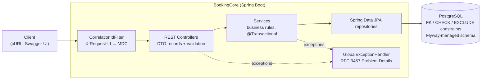
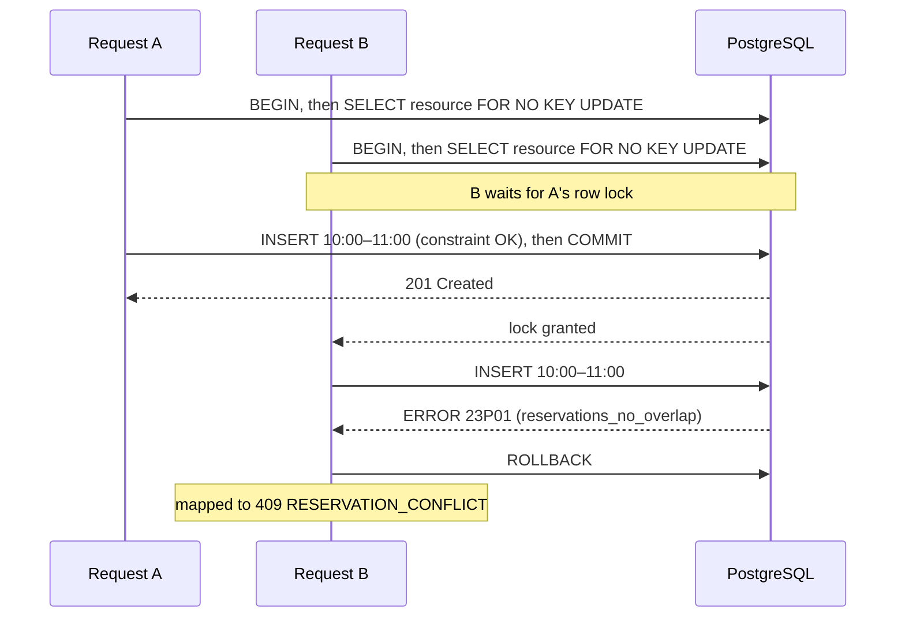
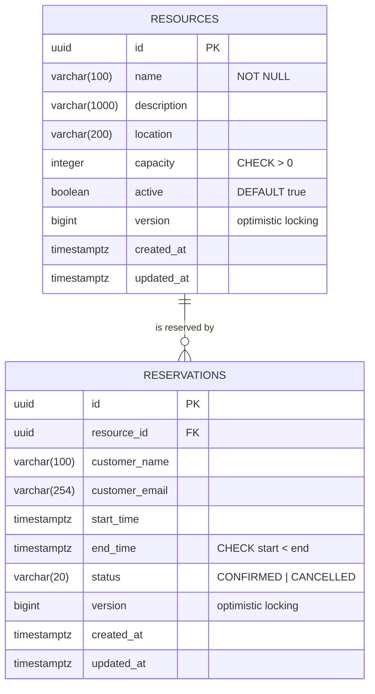

# BookingCore API

**A booking system for meeting rooms, built so that the same room can never be booked twice at the same
time, even when two people press "Book" at the exact same moment.**

Java 21 · Spring Boot 4 · PostgreSQL · Docker · Testcontainers

## What is this?

BookingCore is the **backend** of a room-booking system: the part that stores the rooms and bookings and decides
whether a booking is allowed. It has no web page of its own. Apps and websites talk to it through a **REST API**,
and you can try every feature in the browser through the built-in [Swagger UI](#quick-start).

What it can do:

- **Rooms:** add rooms (name, location, number of seats), list and search them, edit them, or take them out of
  service.
- **Bookings:** book a room for a time slot, view, change or cancel bookings, and search them by room, status or
  date.
- **Availability:** ask "is this room free between 10:00 and 11:00?"

The rules:

| Situation | Result |
|---|---|
| Alex books Room A 10:00–11:00 | ✅ Booked |
| Sam tries Room A 10:30–11:30 | ❌ Rejected: the room is already taken (`409 Conflict`) |
| Sam books Room A 11:00–12:00 | ✅ Booked: back-to-back bookings are fine |
| Alex cancels, then Sam books 10:00–11:00 | ✅ Booked: cancelling frees the slot (the old booking is kept for history) |
| Alex and Sam book Room A 10:00–11:00 **at the exact same moment** | ✅ exactly one succeeds, ❌ the other is rejected |

## The main challenge: two people booking at the same moment

The obvious way to build booking is: *check whether the room is free, and if so, save the booking.* But if two
requests arrive at the same instant, **both checks can run before either booking is saved**. Both see a free
room, both save, and the room is double-booked. It's like two people each checking that a seat is empty, then
both sitting down on it.

BookingCore solves this by putting the rule **inside the database**: *"no two confirmed bookings for the same room
may overlap in time."* The database checks this rule at the moment it saves each booking, so it cannot be fooled
by timing. The losing request gets a clear "already booked" answer. Because the rule lives in the database, it
still holds when several copies of the app run on different servers.

**Proof:** automated tests fire up to 16 bookings at the same instant against a real database, over and over, and
check that there is never an overlap. A manual demo against the running app gives:

```text
20 simultaneous requests for the same room and hour  →  1 booked, 19 rejected, 1 booking stored
```

The [technical deep dive](#concurrency-and-double-booking-prevention) below explains exactly how this works,
including a deadlock the tests uncovered and how it was fixed.

## Highlights for reviewers

- **Correctness under concurrency:** a PostgreSQL exclusion constraint guarantees no overlaps, verified by
  concurrent integration tests against real PostgreSQL (Testcontainers).
- **Clean REST API:** versioned endpoints, validation, pagination, correct status codes, and consistent
  RFC 9457 error responses.
- **Thorough testing:** 136 automated tests (unit, controller and integration), with 95% line coverage.
- **Production habits:** Flyway migrations, Docker Compose setup, CI on GitHub Actions, request IDs in logs, no
  customer data in logs, and health checks.

## Technology stack

| Area | Technology |
|---|---|
| Runtime | Java 21, Spring Boot 4.1 (Spring MVC, Data JPA, Bean Validation, Actuator) |
| Persistence | PostgreSQL 17, Hibernate 7, Flyway 12 SQL migrations |
| API docs | springdoc-openapi 3 (OpenAPI 3.1 + Swagger UI) |
| Testing | JUnit Jupiter 6 (successor to JUnit 5, same API), Mockito, MockMvc, Testcontainers 2, JaCoCo |
| Delivery | Maven wrapper, multi-stage Docker image, Docker Compose, GitHub Actions |

## Architecture



Packages are organised by feature (`resource`, `reservation`, `availability`) with shared `common` (errors,
logging, pagination) and `config` packages. Controllers handle HTTP only and never expose JPA entities. Services
own business rules and transaction boundaries. PostgreSQL enforces the invariants that must hold under
concurrency.

## Concurrency and double-booking prevention

### The race in naive booking systems

```java
if (!repository.existsOverlapping(roomId, start, end)) {   // 1. check
    repository.save(new Reservation(roomId, start, end));   // 2. insert
}
```

Two simultaneous requests can both pass step 1 before either reaches step 2, and both insert. Under PostgreSQL's
default `READ COMMITTED` isolation, neither transaction sees the other's uncommitted row, so `@Transactional`
does not help. Java locks only protect one JVM.

### The solution: PostgreSQL enforces the invariant

[`V3__add_reservation_overlap_constraint.sql`](src/main/resources/db/migration/V3__add_reservation_overlap_constraint.sql):

```sql
CREATE EXTENSION IF NOT EXISTS btree_gist;

ALTER TABLE reservations
    ADD CONSTRAINT reservations_no_overlap
        EXCLUDE USING gist (
            resource_id WITH =,                                -- same resource ...
            tstzrange(start_time, end_time, '[)') WITH &&      -- ... and overlapping interval
        )
        WHERE (status = 'CONFIRMED');                          -- cancelled rows never block
```

- The constraint rejects any row whose `resource_id` matches **and** whose range overlaps an existing row.
- `'[)'` makes intervals half-open, so 10:00–11:00 and 11:00–12:00 do not overlap.
- The `WHERE` clause makes it partial: cancelled reservations stay for history but are ignored.

The check is atomic with the write. PostgreSQL waits for conflicting in-progress transactions before deciding, so
the guarantee holds for every database client: other instances, batch jobs, or someone using `psql`.

### Transaction strategy

[`ReservationService`](src/main/java/com/bookingcore/reservation/ReservationService.java) runs every write that
creates or moves a confirmed reservation in one `@Transactional` method:

1. Validate the input (interval order, start in the future).
2. Lock the resource row (`SELECT … FOR NO KEY UPDATE`) and check that the resource exists and is active.
3. Write and **flush immediately**, so a constraint violation surfaces inside the service.
4. Translate SQLSTATE **`23P01` for the constraint `reservations_no_overlap`** into `409 RESERVATION_CONFLICT`.
   Any other database error is **not** relabelled. Classification uses the driver's SQLSTATE and constraint
   name, not message text ([`PostgresErrors`](src/main/java/com/bookingcore/common/exception/PostgresErrors.java)).
5. Any exception rolls back the transaction. A failed update leaves the original reservation unchanged.

There is no availability pre-check before the insert, so every conflict goes through one tested path.

### Why the resource row lock? (found by the concurrency test)

The first version used only a `FOR SHARE` lock. The repeated 8-way concurrency test then failed in roughly 1 run
in 5. **No overlap was ever stored**, but some losing requests got `500` instead of `409`:

```text
SQLSTATE 40P01: deadlock detected
Where:  while checking exclusion constraint on tuple (2,37) in relation "reservations"
```

When several transactions insert mutually conflicting rows at the same moment, they can wait on each other's
uncommitted index entries in a cycle. PostgreSQL then aborts the victims. Locking the resource row first makes
writers for the **same** room queue up instead. When each one gets its turn, the winner has committed, so the
check fails immediately and cleanly with `23P01` → `409`. The lock also prevents a concurrent deactivation from
slipping in between the "is active" check and the insert. Different rooms lock different rows and stay fully
parallel. As a further safeguard, any remaining transient lock failure maps to `503` with `Retry-After`.



**Multiple instances:** all coordination (row lock, constraint, transaction visibility) happens in PostgreSQL, so
any number of instances share the same guarantee without a distributed lock.

**Availability is informational:** `GET /resources/{id}/availability` can be stale a millisecond later. It is
not a reservation. Only the booking write is authoritative.

### How the tests prove it

[`ConcurrentBookingIT`](src/test/java/com/bookingcore/integration/ConcurrentBookingIT.java) runs against a real
PostgreSQL container. It sends real HTTP requests, each on its own thread, connection and transaction, and
releases them together with a `CyclicBarrier`.

| Test | Contention | Asserts |
|---|---|---|
| Same interval | 2 threads | one `201`, one `409`; exactly 1 confirmed row in PostgreSQL |
| Same interval, `@RepeatedTest(20)` | 8 threads | `1 × 201`, `7 × 409` on every run |
| Random overlapping intervals, `@RepeatedTest(5)` | 16 threads | rows = number of `201`s; an SQL self-join finds **zero** overlapping pairs |
| Different rooms | 2 threads | both succeed |
| Update vs create for the same slot | 2 threads | exactly one wins |

## API documentation

Swagger UI: **<http://localhost:8080/swagger-ui/index.html>** (OpenAPI document at `/v3/api-docs`).

| Method | Path (under `/api/v1`) | Description | Success | Errors |
|---|---|---|---|---|
| `GET` | `/resources` | List; filters `active`, `minCapacity`, `location`; `page`, `size` (≤100), `sort` | 200 | 400 |
| `GET` | `/resources/{id}` | Get a resource | 200 | 400, 404 |
| `POST` | `/resources` | Create (`Location` header) | 201 | 400 |
| `PATCH` | `/resources/{id}` | Partial update; `{"active": false}` deactivates | 200 | 400, 404, 409 |
| `GET` | `/resources/{id}/availability?startTime=…&endTime=…` | Informational check (≤ 31 days) | 200 | 400, 404 |
| `POST` | `/reservations` | Create (`Location` header) | 201 | 400, 404, 409 |
| `GET` | `/reservations` | List; filters `resourceId`, `status`, `from`, `to`; paging | 200 | 400 |
| `GET` | `/reservations/{id}` | Get a reservation | 200 | 400, 404 |
| `PATCH` | `/reservations/{id}` | Partial update of customer details and/or interval | 200 | 400, 404, 409 |
| `POST` | `/reservations/{id}/cancel` | Cancel (idempotent) | 200 | 400, 404, 409 |

```json
{
  "type": "about:blank",
  "title": "Reservation conflict",
  "status": 409,
  "detail": "The selected resource is already booked during this time interval.",
  "instance": "/api/v1/reservations",
  "code": "RESERVATION_CONFLICT",
  "requestId": "2ee14381-8ac0-4cf4-9642-bfd8767ea2fc"
}
```

| `code` | Status | Meaning |
|---|---|---|
| `VALIDATION_FAILED` | 400 | Invalid fields; an `errors` array lists `{field, message}` |
| `MALFORMED_REQUEST` | 400 | Unparseable JSON, a timestamp without an offset, or an invalid UUID |
| `INVALID_TIME_RANGE` | 400 | `startTime ≥ endTime`, start in the past, or invalid range filter |
| `RESOURCE_NOT_FOUND` / `RESERVATION_NOT_FOUND` | 404 | Unknown ID |
| `RESERVATION_CONFLICT` | 409 | Overlaps a confirmed reservation of the same resource |
| `RESOURCE_INACTIVE` | 409 | The resource is deactivated |
| `INVALID_RESERVATION_STATE` | 409 | Updating a cancelled reservation, or cancelling one that has ended |
| `CONCURRENT_MODIFICATION` | 409 | Optimistic-lock (`@Version`) conflict |
| `TRANSIENT_FAILURE` | 503 | Lock timeout or deadlock; nothing changed; safe to retry |
| `INTERNAL_ERROR` | 500 | Unexpected error; details are in the server logs under the `requestId` |

Notes: timestamps need an offset (`+01:00` or `Z`); in query strings, encode `+` as `%2B`. `PATCH` fields that
are omitted or `null` stay unchanged. Cancelling an already cancelled reservation returns `200` unchanged.

## Database schema



Migrations live in [`db/migration`](src/main/resources/db/migration): V1 resources, V2 reservations, V3 the
exclusion constraint, V4 listing indexes. Demo data is in a separate `db/seed` location that is applied only with
the `demo` profile. Hibernate runs with `ddl-auto: validate`, so Flyway owns the schema.

## Quick start

Requires Docker with Compose v2.

```bash
git clone <repository-url>
cd bookingcore-api
docker compose up --build
```

- API: <http://localhost:8080/api/v1/resources>
- Swagger UI: <http://localhost:8080/swagger-ui/index.html>
- Health: <http://localhost:8080/actuator/health>

The default `demo` profile loads Rooms A–C and an inactive workspace with fixed IDs (`11111111-…`, `22222222-…`,
`33333333-…`, `44444444-…`). No `.env` file is needed. To override the local defaults, run
`cp .env.example .env` and edit it. Reset with `docker compose down --volumes`. Ports are bound to `127.0.0.1`.

**Without Docker for the app** (JDK 21 + PostgreSQL 13+; `docker compose up postgres` is enough):

```bash
export DB_URL=jdbc:postgresql://localhost:5432/bookingcore DB_USERNAME=bookingcore DB_PASSWORD=bookingcore
./mvnw spring-boot:run -Dspring-boot.run.profiles=demo
```

Other variables: `SERVER_PORT` (default 8080), `DB_POOL_SIZE` (10), and `LOGGING_STRUCTURED_FORMAT_CONSOLE=ecs`
for JSON logs. `./mvnw spring-boot:test-run` starts the app against a throwaway Testcontainers PostgreSQL instead.

## Example workflow (cURL)

Room A in the demo data is `11111111-1111-1111-1111-111111111111`. Use future dates.

```bash
API=http://localhost:8080/api/v1
ROOM=11111111-1111-1111-1111-111111111111

# 1. Create a room → 201 + Location header
curl -i -X POST $API/resources -H 'Content-Type: application/json' \
  -d '{"name":"Room D","location":"Floor 4","capacity":6}'

# 2. List available rooms
curl "$API/resources?active=true&minCapacity=6"

# 3. Create a reservation → 201, {"id":"<reservation-id>", ..., "startTime":"2027-03-15T09:00:00Z"}
curl -i -X POST $API/reservations -H 'Content-Type: application/json' -d '{
  "resourceId": "'$ROOM'", "customerName": "Alex Jensen", "customerEmail": "alex@example.com",
  "startTime": "2027-03-15T10:00:00+01:00", "endTime": "2027-03-15T11:00:00+01:00"}'

# 4. Retrieve it
curl $API/reservations/<reservation-id>

# 5. Overlapping reservation → 409 application/problem+json, "code":"RESERVATION_CONFLICT"
curl -i -X POST $API/reservations -H 'Content-Type: application/json' -d '{
  "resourceId": "'$ROOM'", "customerName": "Sam Holm", "customerEmail": "sam@example.com",
  "startTime": "2027-03-15T10:30:00+01:00", "endTime": "2027-03-15T11:30:00+01:00"}'

# 6. Cancel the first reservation (idempotent)
curl -X POST $API/reservations/<reservation-id>/cancel

# 7. The same interval can be booked again → 201
curl -i -X POST $API/reservations -H 'Content-Type: application/json' -d '{
  "resourceId": "'$ROOM'", "customerName": "Sam Holm", "customerEmail": "sam@example.com",
  "startTime": "2027-03-15T10:00:00+01:00", "endTime": "2027-03-15T11:00:00+01:00"}'
```

## Concurrency demo

With the stack running, send 20 identical bookings in parallel:

```bash
BODY='{"resourceId":"11111111-1111-1111-1111-111111111111","customerName":"Racer","customerEmail":"racer@example.com","startTime":"2027-03-16T13:00:00Z","endTime":"2027-03-16T14:00:00Z"}'

seq 1 20 | xargs -P 20 -I{} curl -s -o /dev/null -w "%{http_code}\n" \
  -X POST http://localhost:8080/api/v1/reservations -H 'Content-Type: application/json' -d "$BODY" | sort | uniq -c
#       1 201
#      19 409
```

This is the output from an actual run during development. A direct `psql` count of confirmed overlapping rows
returns `1`. Inserting an overlapping row with plain SQL is rejected too, with no application code involved.

## Testing

```bash
./mvnw clean verify          # unit + integration tests, packaging, JaCoCo report (Docker required)
./mvnw test                  # unit and MockMvc tests only (no Docker)
./mvnw verify -DskipUTs      # integration tests only
```

- **Unit tests (Mockito, fixed `Clock`):** interval semantics (including ±1 second boundaries), business rules,
  the 23P01 → 409 translation, and checks that other integrity violations are *not* mislabelled.
- **MockMvc slice tests:** status codes, JSON contract, validation errors, Problem Details structure, pagination
  defaults and cap, and 409/503/500 mapping without leaking internals.
- **Integration tests (Testcontainers PostgreSQL):** full CRUD with persistence checks; overlap rules
  (back-to-back, 1-second overlap, containment, cancel frees the slot); a failed update leaves the row unchanged;
  schema constraints tested with plain SQL; health, OpenAPI and correlation IDs; and the concurrency suite above.

Latest local result: **62 unit/slice + 74 integration tests, 0 failures**. JaCoCo reports 95% line and 79% branch
coverage (`target/site/jacoco/index.html`).

## Technical decisions

| Decision | Reason | Trade-off |
|---|---|---|
| Exclusion constraint as the single authority | Atomic; works across instances and for every DB client | Deliberately PostgreSQL-specific |
| No pre-check before insert | One source of truth, one tested path | A conflict costs one rolled-back statement |
| Per-resource row lock before writing | Prevents exclusion-check deadlocks; closes the deactivate-vs-book race | Writes to the same room are serialized |
| `READ COMMITTED` isolation | The constraint and lock already provide the guarantees | No `SERIALIZABLE` retry loops needed |
| `@Version` optimistic locking | Prevents lost updates on the same record | Clients retry on `CONCURRENT_MODIFICATION` |
| `Instant` + `timestamptz`, microsecond clock | No ambiguous local times; responses match stored values | Clients must send offsets |
| DTO records; resource referenced by ID | Stable API contract; no lazy-loading surprises | A little mapping code |

## Known limitations

- **No authentication or authorization.** Anyone who can reach the API can change any reservation and read
  customer emails. This is for local and demo use only; do not expose it publicly.
- No idempotency keys, so a retried `POST` can create a second, non-overlapping reservation.
- One reservation per resource at a time; capacity is informational.
- No business rules for opening hours, booking horizon or maximum duration.
- Writes to the same resource are serialized (fine for rooms, not for very high-throughput resources).
- No rate limiting.

## Future improvements

- JWT authentication with role-based access (customers manage their own reservations, admins manage resources)
- `Idempotency-Key` support and `ETag`/`If-Match` on updates
- Multi-capacity resources (for example, desks in a shared area)
- Rate limiting, Micrometer/Prometheus metrics, OpenTelemetry tracing
- Event-driven notifications using a transactional outbox
- Cloud deployment with a managed PostgreSQL

## License

[MIT](LICENSE)
